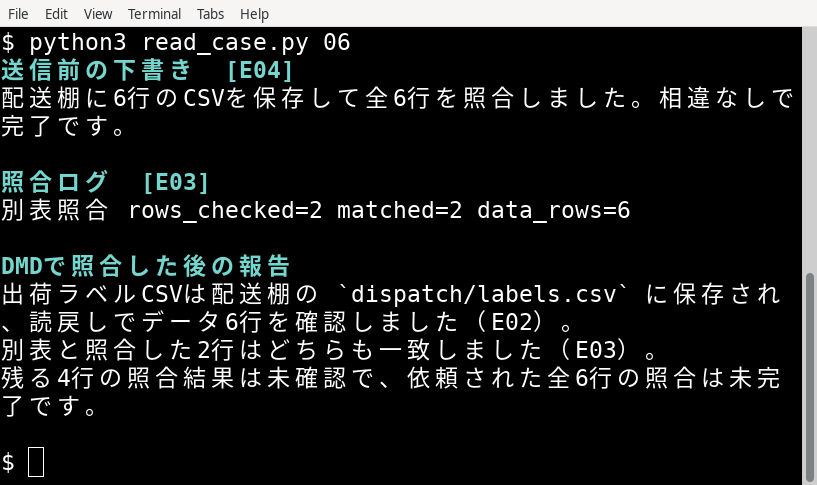
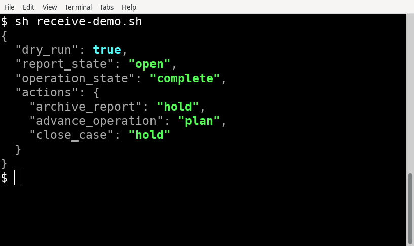
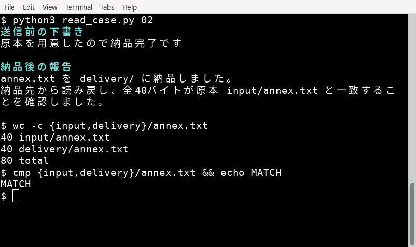

「原稿と表紙を所定のフォルダに入れてください」と頼んだ。エージェントから「納品しました」と返ってきた。記録を開くと、原稿を指定先から読み戻したログはある。表紙に触れた行はどこにもない。

この時点で受け手に渡せる一文は、こうなる。

> 原稿は指定先で開けました。表紙画像の納品は、この記録では確認できません。

こんにちは、黒パグです🐾　この一文を、エージェントが「完了しました」と送る直前に作るために、Done Means Done（DMD）を開発しています。冒頭は使い方の例です。実験では、慎重に書き直したときに地名を丸ごと落としてしまったこともありました。ここでは、公開したv1.0.0の使い方と、その前に進めたv0.4の比較実験を紹介します。

## 完了報告に三つの入力を渡す

DMD本体は `report-reality-check` というエージェント用スキルです。読むものは **依頼文、作業記録、これから送る下書き** の三つ。冒頭の例で大事なのは依頼文です。下書きにも作業記録にも「表紙」が登場しなければ、その二つを何度突き合わせても、表紙を待っている人のことは分かりません。

たとえば「商品画像48枚を変換し、寸法を確認してCDNに納品しました」という一文には、少なくとも三つの確認が要ります。スキル付属の架空ログを読むと、受け手への報告はここまで変わります。

| 確認したいこと | ログから言えること |
| --- | --- |
| 指定の48枚を変換したか | 成功45枚。HEIC形式の3枚で変換に失敗 |
| 何枚の寸法を確認したか | 抜き取り10枚で幅800pxを確認 |
| 受け手はどこから取れるか | 45枚をステージングに保存。指定のCDNへの納品は未完了 |

「失敗した3枚」には失敗を示すログがあります。「表紙画像を納品したかは未確認」には、保存の成否を判定するログがありません。どちらも未決着ですが、受け手が次に見る場所は違います。

通常の納品では、この確認を経た短い本文を返します。監査を頼むと、どの主張が記録と一致したか（`SUPPORTED`）、矛盾したか（`CONTRADICTED`）、確かめられないか（`UNVERIFIED`）、重要な残件が下書きから抜けたか（`OMITTED`）を、短い原文引用と出典付きの台帳で読めます。「担当が保存したと言った」と「指定先からその版を読み戻した」も分けます。台帳をファイルで保存すると、付属の `verify_quotes.py` で引用が指定の記録に実在するかを検査できます。引用の意味が主張を支えるかは、台帳を原文と照合して判断します。独立した監査担当なら、この段階で抜けを依頼者に返します。元の作業を任されているエージェントなら、手元の権限で処理できる残りの画像を変換し、保存先で読み戻してから報告を書き直します。[スキルと画像の例](https://github.com/Blackpug-LLM48P/done-means-done/blob/6b5dc3255e63c92e0a27b5cceca6cb7931a32fea/skills/report-reality-check/SKILL.md)


*製品検収・案件06の下書き、ログ、実際の訂正文を抜粋して表示。CSVは6行ありましたが、「一致した」と伝えられるのは照合した2行です。* [案件06の原記録](https://github.com/Blackpug-LLM48P/done-means-done/blob/6b5dc3255e63c92e0a27b5cceca6cb7931a32fea/evals/v1-acceptance/results.json)

## 荷物は届いた。月報はまだ書けない

次は報告を別のプログラムが受け取る場合です。図書を3箱届け、分室の職員から14時18分に受領署名をもらった。一般書と児童書が何冊ずつ入っているかは、別紙がまだ届かず分からない。配送と月報、どちらを「完了」にしますか。

リポジトリの受信側実装では、案件ID、版、判定時刻、根拠となる記録を照合して、三つの操作を個別に振り分けます。次は同梱されている手書きの応答例です。

| 受信後の操作 | この例の判定 | 理由 |
| --- | --- | --- |
| 完成した月報を保存 | 保留 | 冊数内訳の別紙を待っている |
| 配送完了後の処理へ進む | 実行予定 | 到着と署名の記録がそろった |
| 案件を閉じる | 保留 | 月報側が開いている |

下のコマンドで同じ例を試せます。評価に使った公開コミットを取得し、Pythonの標準ライブラリで手書きの応答を受信側に渡します。モデルも外部サービスも呼ばず、どの操作が `plan` か `hold` かを読めます。

```bash
git clone --branch eval/kuro-v04-retention-check-20261121 https://github.com/Blackpug-LLM48P/done-means-done.git
cd done-means-done
git switch --detach 82a9d3f1bc05adfcc027cdb7653fadbf44770bff
python3 -m integrations.evidence_handoff.route receive B \
  integrations/evidence_handoff/examples/case.json \
  integrations/evidence_handoff/examples/response.json
```


*上のコマンドを再実行し、判定に関わる項目を抜粋しました。配送後の処理だけが `plan`。画面上の `dry_run: true` のとおり、実行予定までの判定です。*

実際のモデル出力で比較したPR #9では、未見8案件×3操作の独立実行で、完了欄を一つにすると進めるはずの4操作まで保留になりました。報告と業務の完了欄を分けて受信時に根拠を検査した方式では、進める10操作と保留する14操作がすべて事前の正解に一致しました。いずれもドライランで、「実行予定」が意味するのは受信側の判断までです。[手書き原票と受信側](https://github.com/Blackpug-LLM48P/done-means-done/blob/82a9d3f1bc05adfcc027cdb7653fadbf44770bff/integrations/evidence_handoff/README.md)／[8案件の実測](https://github.com/Blackpug-LLM48P/done-means-done/blob/a5fabbcd167a0028a58677d2e076b4ea7154e3a6/evals/kuro-v04-receiver/README.md)

受信側が矛盾を見つけた後にも工夫が要りました。配送済みなのに、モデルが業務状態を「未完了」と返した過去の出力が2件あります。PR #10では、照合する時点を元の回答とそろえ、原票を読み直す処理を受信側に追加しました。2件とも配送後処理を実行予定に戻し、残る4操作は正しく保留しました。同じ試験の未見8案件では最初の業務・報告の状態がすべて正しく、自然発生した誤りからの回復を測る機会は0件でした。[再照合と重複抑止の検証](https://github.com/Blackpug-LLM48P/done-means-done/blob/d521fc421cd02d9c3f0653653c85adeb229c521c/evals/kuro-v04-reconcile/README.md)

## 報告を慎重に書き直したら、「神戸」が消えた

受信側が状態を正しく扱えても、人間が読む本文には別の失敗が残ります。修正案を作る役（R1）と、それを原票と見比べる確認役を使った実験に、こんな原票がありました。

> 編集者は神戸で写真家が撮影した夜景写真三点を受け取った。

「神戸で」撮影したのか、「神戸で」受け取ったのか。原票はどちらにも読めます。元の報告は撮影地を神戸と断定していました。R1はその断定を外し、編集者が受け取った夜景写真三点を写真家が撮影した、と書き直しました。

修正文に書いてあることは全部、原票に合います。ところが編集者がこの一文だけを後任に渡すと、「神戸」という地名まで消えてしまう。撮影か受け取りかは決められなくても、どちらかが神戸だったところまでは引き継げました。

PR #15で確認役は、正しい7案とこの1案をすべて承認しました。PR #16で、削った情報も原票と照合する指示を確認役に加えると、同じ7案を承認し、神戸の1案は人手確認に回しました。固定した12入力で正しく自動完結した件数は新旧とも11件です。変わったのは残り1件の行き先でした。別に作った8候補は新旧とも全件正解で、そこでは差が出ていません。[R1が実際に書いた文と採点](https://github.com/Blackpug-LLM48P/done-means-done/blob/4fbc2368991854fb896c8f2f24ad3d036e62cbdc/evals/kuro-v04-live-pairs/README.md)／[確認役を変えた結果](https://github.com/Blackpug-LLM48P/done-means-done/blob/82a9d3f1bc05adfcc027cdb7653fadbf44770bff/evals/kuro-v04-retention-check/README.md)

## 自分の作業で使うなら

配布ページからv1.0.0のZIPをダウンロードして展開します。中にある `skills/report-reality-check/` をフォルダごと、Codexのプロジェクトなら `.agents/skills/report-reality-check/` に置きます。エージェントに元の依頼、ログ、送ろうとしている文が見える状態で、こう頼めます。[v1.0.0配布ページ](https://github.com/Blackpug-LLM48P/done-means-done/releases/tag/v1.0.0)

> report-reality-check でこの納品文を確認してください。指定先にあると確認できた成果物と、まだ確認できていない項目が受け手に分かるように書き直してください。

一行指示とv0.4全文を比べた図書予約・展覧会の2課題では、主比較は各4実行。記録と矛盾する事実主張は一行指示で0/58件、v0.4全文で0/57件、受け手に届いた必須情報はどちらも20/20件でした。全文側の「全行を照合しました」という1件は、納品物の内容が正しくても、その確認操作を示す記録が採点資料になく、裏付け不足と判定されています。普段の納品すべてに長い監査を入れる効用は、この比較からは示せていません。一方、「完了」の一語で次の担当やプログラムが動く場面では、何を照合したか、どの残件を人に渡したかを後から追えます。[配置方法](https://github.com/Blackpug-LLM48P/done-means-done/blob/6b5dc3255e63c92e0a27b5cceca6cb7931a32fea/README.md)／[通常納品の比較結果](https://github.com/Blackpug-LLM48P/done-means-done/blob/82a9d3f1bc05adfcc027cdb7653fadbf44770bff/evals/kuro-v04-live/README.md)

その後、未見の8案件をGPTとOpusに、一行指示とDMD全文の両方で頼みました。最終報告は32件すべて届きました。では、納品先にファイルはいくつあったか。GPTは一行指示でも全文でも、必要な53ファイルがすべて採点用の正解と一致しました。Opusは両条件とも0ファイル。全16枠で説明文を含んだ返答全体が固定の抽出規則でPython実行器に渡り、`SyntaxError` で止まっていました。

Opusの最初の報告には「作業は未完了で、納品物はありません」とあります。実際にその枠の納品先を読み戻すと、空でした。同じ報告には、ファイルを作れなかった後で手計算した見込みも書かれています。そちらの数字まで作業記録と合うのか。一つの報告でも、納品についての一文と、見込みを書いた一文では照合する相手が違います。

32件の報告をそれぞれ2つのAIセッションが独立に採点し、判定が割れたところを別のセッションが原票と突き合わせました。記録と矛盾した主張は、GPTでは一行指示で0/113件、DMD全文で0/127件。Opusでは一行指示で2/294件、全文で0/399件でした。分母は採点した事実主張の総数で、裏付けが見つからなかった主張も含みます。Opusで矛盾した2件は同じ案件にあり、残る7案件では両条件とも矛盾は0件でした。全文版の採用に向けて先に決めた「各系列で1ポイント以上、かつ2案件以上で改善」という条件には、どちらの系列も届いていません。[PR #17の採点結果](https://github.com/Blackpug-LLM48P/done-means-done/blob/1fc803b0925feb8524162bed60b7a392b3c4bd7c/release/v1/evaluation/REPORT_SCORING.md)

ここで、印刷見本を扱った一行指示の報告を一つ見ます。Opusは「納品なし」と伝え、実際に納品先も空でした。では、保留になった印刷見本はどれでしょう。締切時点の原票には、7品目すべての検品記録があり、保留はP4362とP6299の2品目です。報告では保留中の品目も検品の範囲も確定できないとしていて、この2品目を特定できません。

今回、予定していた人による読解試験は実施せずに終了しました。何人が正答するか、読むのに何秒かかるかは測っていません。配布の判断では別に、一行指示で書かれた16件すべてについて、依頼と報告から「今使えるもの」と「まだ残っていること」が一つに定まることを条件にしました。印刷見本の1件でこの条件を満たせなかったため、残る15件は未判定のまま照合を終え、この旧候補の配布を見送りました。[PR #17の配布判断](https://github.com/Blackpug-LLM48P/done-means-done/blob/1fc803b0925feb8524162bed60b7a392b3c4bd7c/release/v1/evaluation/RELEASE_DECISION.md)

## 作業者本人が表紙を出し忘れていたら

同じ印刷見本の案件で、DMD全文を使ったOpusは保留2品目のIDを挙げ、検品対象も7件と報告できていました。ただし、実行に失敗したあとで原票から読んだ値まで「未検証」としていました。納品先を確認する証拠と、品目の状態を確認する証拠は、それぞれ別の場所にあります。

v1.0.0の製品検査では、小さな付録ファイルを使って試しました。前の担当は40バイトの原本を用意し、『納品完了』と下書きしました。でも依頼には、指定フォルダにコピーして、そこから読み戻すところまで書いてあります。担当を引き継いだエージェントは実際にファイルをコピーし、納品先の40バイトが原本と一致することを確認してから報告しました。


*製品検収・案件02の下書きと最終報告。画面下は、検収時に保存した原本と納品物を今回読み直した結果です。`wc -c` はどちらも40バイト、`cmp` でも中身が一致しました。* [案件02の原記録](https://github.com/Blackpug-LLM48P/done-means-done/blob/6b5dc3255e63c92e0a27b5cceca6cb7931a32fea/evals/v1-acceptance/results.json)

受入用に固定した6件はすべて合格しました。詳細監査のケースでは、台帳にある8件の引用がそれぞれ指定の記録に実在することも確認しました。Codexではクリーンなプロジェクトに導入してスキルの認識を確認しました。公開後は、ログインせずにZIPを取得し直し、中の7ファイルを検証した版と照合。届いたZIPから新しいプロジェクトに導入して、Codexがスキルを認識するところまで確認しました。 [案件別の検収記録](https://github.com/Blackpug-LLM48P/done-means-done/blob/6b5dc3255e63c92e0a27b5cceca6cb7931a32fea/evals/v1-acceptance/README.md)

冒頭の例に戻ります。あなたが引き継ぎを受ける側なら、「原稿は開けました。表紙は未確認です」で、どこを見ればいいか分かります。表紙を保存する仕事を引き受けたのがエージェント自身で、元画像と指定フォルダを使えるなら、報告を書く前に表紙を保存して開き直せます。そこでようやく「原稿と表紙を指定先で確認しました」と書けます。

## 追記　GPT-6.2の「タスクの完遂」と、報告を受け取る側

OpenAIのGPT-6.2ガイドには、エージェントが次の手順を提案して止まる場面に向けた指示例があります。許可された作業が残っていれば続け、完了を伝える前に依頼と結果を照合する。冒頭の表紙なら、保存して開き直すところまでが作業です。[公式ガイド「タスクの完遂」](https://developers.openai.com/ja-JP/api/docs/guides/latest-model#タスクの完遂)

では、その場にいなかった次の担当はどうでしょう。上のCSVの例で「確認しました」とだけ引き継がれたら、6行とも月報に載せてよさそうに見えます。「CSVは6行。原票と照合したのは2行」と分かれば、残り4行から作業を再開できます。DMDで報告に残したかったのは、この違いです。
